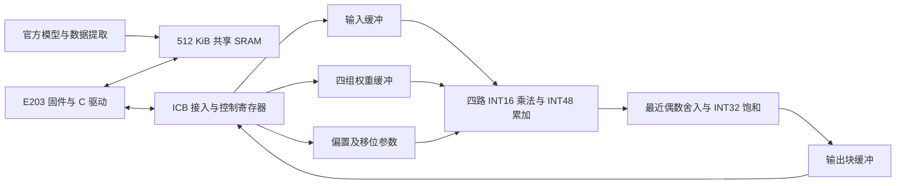

# 轻语：基于 RISC-V 的端侧语音识别前馈线性加速器

本报告记录当前功能工程及本地验证，作为参赛技术报告草稿。
尚未完成指定 SRAM 宏映射、正式 150 MHz 静态时序和完整系统功耗验收，不能把本报告表述为最终赛题验收通过。

## 设计目标与范围

设计面向本科生组三项必做任务：64 项点积与数值处理、完整前馈第一线性层、
E203 集成与逻辑综合。一个任务计算
`Y[99,256] = X[99,64] × W[64,256] + b[256]`，共 1,622,016 次乘累加。
同一套硬件支持十二组编码器参数逐层更新，处理器负责调度及数据搬运。

采用固定提交的 KWT-1 原始 best_weights，不训练、不微调、不蒸馏。
音频预处理与浮点模型在电脑端执行，各层输入取注意力、残差及第一处 LayerNorm 之后的张量。
硬件承担矩阵运算、偏置和输出数值处理，E203 不代算必做数值任务。

## 硬件架构

一次装载 64×4 权重，在 99 行输入之间复用，输出 99×4 结果块。
每层共 64 个块；本层输入驻留内部缓存，参数和结果通过 E203 与共享 SRAM 交换。
当前同步存储基线每个 k 使用读取、累加两拍，每行四个结果通过共享写口顺序保存。

内部存储使用指定宽深规格的功能封装：2 个 16×4096 输入宏、4 个 16×128 权重宏、
1 个 16×128 元数据宏、2 个 16×1024 输出宏，合计 174,080 bit，即 21.25 KiB。
当前这些封装采用同步行为模型，真实宏的控制极性、读取延迟及物理视图仍需接入。

SoC 基于官方 Hummingbirdv2 源码，保留 CPU 和原有外设。生成适配层增加共享 SRAM、
FIO 从设备和测试启动向量，原 vendor 源码不被覆盖。具体地址、寄存器与端序见
[统一接口约定](engineering_contract.md)。

## 数值方案

输入和权重为对称 INT16，偏置与累加为有符号 48 位，输出为 INT32。
输入尺度按层设置，权重尺度和输出移位按输出通道设置，尺度为 2 的整数次幂。
偏置与乘积处于同一数值尺度；输出执行最近偶数舍入及显式饱和。
内部 48 位越界由硬件报告错误，禁止静默回绕。

量化参数仅从训练划分冻结，验证阶段不再更新。软件整数模型与硬件采用相同的
乘加顺序、偏置编码、移位和舍入，解码器只还原数值尺度。详见 [数值格式](numeric_format.md)。

## 数据与精度验证

原始数据为 Google Speech Commands V2，完整归档 2,428,923,189 字节，
MD5 为 `6b74f3901214cb2c2934e98196829835`，完整解压后包含 105,835 个 WAV（含背景录音）。
使用指定提交的原始数据加载器准备 256 条训练校准、256 条独立验证样本，
两组都覆盖 12 类，样本 ID 不重叠，测试划分未用于调参。

| 本地指标 | 结果 |
|---|---:|
| 十二层按层汇总后最大 NRMSE | 0.0156474516% |
| 验证输入裁剪数 | 0 |
| 输出饱和数 / 被验证输出数 | 7 / 77,856,768 |
| 十二个硬件任务中的最大 NRMSE | 0.0060370981% |
| 硬件任务标签覆盖 | 0–11，各一个 |

NRMSE 按每层全部验证输出累计平方误差和参考平方值计算，不平均每条样本的误差比例。
这些数据来自本地独立验证子集，不代表组委会冻结的 600 条评测集。
原始样本 ID、逐层统计、量化配置及来源校验值见
[数值验证报告](../model/full_v2_run/validation_vectors/validation_report.json)。

本地推理环境为 TensorFlow 2.14.1、Addons 0.22.0、NumPy 1.26.4；
原仓库参考环境为 TensorFlow 2.4.0rc1，版本差异已记录。
检查点恢复使用对象匹配断言，提取结果还与独立 `X@W+b`、原始 Transformer 输出交叉核对。

## 功能与集成验证

| 层级 | 覆盖及结果 |
|---|---|
| 数值单元 | 11 项测试通过，覆盖符号、舍入中点、饱和、48 位溢出、打包和 NRMSE |
| ICB 控制 | 忙时访问、响应背压、非法地址/写掩码、复位中止及恢复通过 |
| 十二层 RTL | 冻结真实验证向量，304,128 个输出全部逐位一致 |
| 实际 E203 | 执行 C 驱动完成第 11 层真实语音验证任务，25,344 个结果一致 |
| 综合网表 | 实际本地标准单元模型，396 个输出、10,310 次总线事务和 28,834 个稳定周期比较通过 |

E203 工程测试保留原时钟/低速域控制，明确设置 ITCM 固件启动地址，并在源文件前统一
仿真时间单位。Icarus 全 SoC 执行速度较慢，保留其构建与诊断记录；完整运行采用
支持时序事件的原生 Verilator，使用相同固件、共享存储图像及结果检查器。
真实语音任务的驱动调试窗口为 2,457,056 个周期，统计包括输入/参数搬运、计算和结果复制，
但开始前共享 SRAM 已由测试环境预装，因此不能直接作为官方性能评分。

## 逻辑综合与面积

使用用户提供的 SMIC 40 nm 标准单元库进行本地 Yosys 映射，SRAM 保留黑盒。
当前生产流程保留源状态编码（`synth -nofsm`），得到 12,825 个标准单元及 9 个 SRAM 实例。
标准单元面积为 **18,360.5436 µm²，即 0.0183605436 mm²**。
全部 1,027 个同名单元的 Liberty 面积与 LEF 宽×高交叉一致。

该面积仅覆盖 `qingyu_accel` 逻辑，排除九个 SRAM 宏及独立 FIO 适配器，不能作为
完整加速器面积。自动 FSM 重编码映射曾出现四态控制差异，原始失败证据已归档；
保留原状态编码后，同一综合网表测试通过。该结果是采样功能一致检查，非正式等价证明或 STA。

## 同条件优化对照

对同一个冻结真实验证任务，将通道数设为 1 和 4，其他数值配置、运算量、时钟和期望输出不变。
两者均通过 25,344 个输出，未重新校准。

| 指标 | 单路 | 四路 |
|---|---:|---:|
| 内部计算窗口周期 | 3,296,768 | 844,736 |
| 测试主机 MMIO 窗口周期 | 3,498,880 | 1,044,864 |

内部计算周期比为 3.90272，测试主机窗口周期比为 3.34865。
这些结果支持四路并行和数据复用的架构选择，但不是完整 E203 吞吐量、功耗或面积对比。
实验细节、记录和边界见 [创新实验说明](innovation.md)。

## 最终验收前剩余工作

1. 取得兼容的 16×128、16×1024、16×4096 SRAM 宏模型及其时序、功耗、面积视图。
2. 接入真实宏并重新核对读取延迟、控制极性、功能与综合一致性。
3. 在明确的工艺角、I/O 条件和互连假设下完成 150 MHz 静态时序，以及包含 SRAM 和接口的总面积统计。
4. 在同一冻结配置下获取完整活动覆盖，完成 E203、互连、加速器及 SRAM 的动态/静态功耗和任务能耗。
5. 适配组委会最终装载与评测工程，使用冻结配置接受官方 600 条样本复核。

所有设计来源、源码版本和工具辅助贡献见 [来源记录](source_origins.md)。
源码和产物校验值由 `scripts/freeze_manifest.py` 记录，提交前需确认报告与工程一致。
